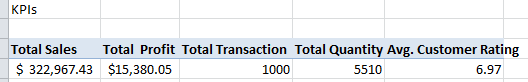

# Kursy Supermarket Sales Analysis and Dashboard

## What Problem does this Analysis solves?
The supermarket has three branches and many product lines, but management cannot easily see what drives sales and profit. The analysis shows what is selling, where, to whom and when. That makes it possible to put effort and money where they will have the most impact.

## Introduction
This Kursy Supermarket Analysis was created to help the supermarket Manager investigate:
- The total sales generated by the supermarket
- The total profit earned by the supermarket
- Which product line generates the highest sales
- Which city contributes the most sales
- Which branch generates the highest profit
- Which payment method is used most by customers
- How have sales changed over time
- Which customer type (Member or Normal) spends more

The data is from Kursy Supermarket gathered over time, which provides a foundation in analyzing data using this powerful tool. The data contains detailed information on Invoive ID, Branch, City, Customer type, Gender, Product Line, Unit price, Quantity, sales, date, time, payment, Cost of goods sold (cogs), payment, rating.

I used one workbook for the Analysis, and dashboard which can be found at [Kursy Supermarket](KURSY%20SUPERMARKET%20ANALYSIS.xlsx)

## Excel Skills Used

The following Excel skills were utilized for analysis:

- Charts/Dashboard
- Pivot Table
- Slicers
- Data Validation

## KPIs

- Total Sales
- Total Profit
- Total Transactions
- Average Order Value
- Average Customer Rating

## Pivot Table
I used a pivot table to analyze and summarize the data, with a clear view of the KPIs.

## Dashboard
A summary of key results with charts and slicers. [Dashboard](KURSY%20SUPERMARKET%20ANALYSIS.xlsx)

## Raw Data Sheet
The raw and already cleaned data.

## The total sales generated by the supermarket and Total profit earned by the supermarket

The supermarket made $322,967 in sales from 1,000 transactions. The average order was about $323.
Profit was $15,380, which is only about 4.8% of sales. Every product line and branch earns this same margin, so profit rises and falls with sales.

## Which product line generates the highest sales

Food and beverages sold the most at $56,145, or 17% of all sales. Sports and travel ($55,123) and Electronic accessories ($54,338) follow closely. Health and beauty is the lowest at $49,194.

## Which city contributes the most sales

Naypyitaw brought in $110,569 (34% of sales). Yangon ($106,201) and Mandalay ($106,198) are almost tied.

## Which branch generates the highest profit

Branch C (Naypyitaw) made $5,265. Branches A and B each made about $5,057. Branch C earns more with fewer transactions (328) because its customers spend more per order ($337 on average).

## Which payment method is used most by customers

Ewallet was used most often (345 transactions), but Cash is almost the same (344). Cash also brought in the most money ($112,207). Credit card is used least (311).

## How have sales changed over time?

- January: $116,292
- February: $97,220, a 16% drop
- March: $109,456, a 13% recovery, but still below January

## Which customer type (Member or Normal) spends more?

Members spend more. Their total was $164,224, compared with $158,743 for Normal customers. Per order, Members spend about $328 and Normal customers about $318. The gap is small, only about 3%.

## INSIGHTS and What decision should this analysis support
- Stocking and promotions: Keep products like Food and beverages well stocked. Run promotions to lift Health and beauty, which is the weakest line.

- Branch performance: Study what Branch C does well and copy it in A and B, for example product mix or upselling.

- Staffing and timing: Schedule more staff on Saturdays and around 7 PM. Investigate why February dropped and plan campaigns for slow periods.

- Customer loyalty: Members spend only slightly more than Normal customers. The membership program could offer better rewards, or the supermarket could push more customers to join.

- Margins: At 4.8% profit, small cost savings or price changes would have a big effect.

- Saturday is the best sales day, and 7 PM is the busiest hour.
- Female customers spend more in total ($167,883) than male customers ($155,084).
- Customer ratings are about the same everywhere, averaging 7.0 out of 10. This suggests service quality is steady across branches.

## Who is going to use these insights?
- Store and branch managers: to compare branches and plan staffing.

- Marketing team: To design promotions and the membership program.

- Purchasing and inventory team: To decide what to stock more or less.

- Senior management or owners: To track overall sales and profit and decide where to invest.

## Limitations
The data covers only 3 months, so it can’t show a full-year trend or seasonality.
Profit is a flat percentage on everything, so the data can’t show which products are truly more profitable.
The differences between cities, payment methods and customer types are small, so treat them as hints rather than strong conclusions.

